# SOC282 – Phishing Alert: Deceptive Mail Detected (LetsDefend)

## Overview / Objective

This writeup covers my investigation of **SOC282 – Phishing Alert – Deceptive Mail Detected**, a Security Analyst–level lab on the **LetsDefend** SOC simulation platform. The alert is triggered by the email gateway when a message looks like phishing, and the job is to work out whether the email is really malicious, whether the user interacted with it, and whether the endpoint was compromised.

The core learning objectives were:

- Triage a phishing alert from the Monitoring queue through to closure
- Analyse an email and the file it delivers (hashing, VirusTotal reputation checks)
- Use threat intelligence to assess the sender's SMTP infrastructure
- Correlate **endpoint telemetry** with **network logs** to confirm (or rule out) malware execution

> **A note on how this investigation unfolded:** I worked this case in two parts. After finishing my first pass, I scored the alert as a true positive with no execution. Questions in the LetsDefend module then showed me I had skipped a key step: I never checked Felix's endpoint itself. Part Two covers that follow-up and it changed the outcome of the case. I've kept both parts in this writeup because the mistake is a useful lesson on its own.

---

## Scenario / Prerequisites

**Scenario:** The email security gateway flagged an inbound message to a user at the organization as a possible phishing attempt. The gateway's device action was **Allowed**, so the email was delivered to the recipient's mailbox. I had to decide whether it was malicious and whether any user or system had been impacted.

**Platform and tools used:**

- LetsDefend (Monitoring, Case Management, Email Security, Endpoint Security, Log Management, Threat Intelligence)
- LetsDefend sandbox environment (for safe file download)
- PowerShell (`Get-FileHash`)
- VirusTotal

### Alert Details

| Field | Value |
|---|---|
| **Alert Name** | SOC282 – Phishing Alert – Deceptive Mail Detected |
| **Event ID** | 257 |
| **Event Time** | May 13, 2024, 09:22 AM |
| **Level** | Security Analyst |
| **Event Type** | Exchange |
| **SMTP Address** | 103.80.134.63 |
| **Sender** | `free@coffeeshooop.com` |
| **Recipient** | `Felix@letsdefend.io` |
| **Email Subject** | Free Coffee Voucher |
| **Device Action** | Allowed |

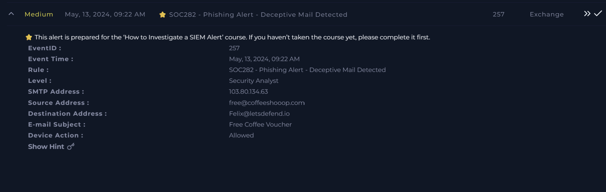

---

# PART ONE – Initial Investigation

## Phase 1: Alert Intake and Initial Assessment

I started by assigning the alert to myself and creating an investigation case, then read through the alert details.

The gateway had flagged a potential phishing email sent from `free@coffeeshooop.com` to `Felix@letsdefend.io` with the subject:

```
Free Coffee Voucher
```

Phishing relies mostly on social engineering rather than technical exploits, so my first goals were to see whether the email carried the usual phishing traits and whether anyone had already interacted with it.

---

## Phase 2: Email Analysis

I opened the **Email Security** dashboard and searched for messages from:

```
free@coffeeshooop.com
```

The search returned a single email, addressed to `Felix@letsdefend.io`. Reading it, I spotted several classic phishing indicators straight away:

- **A free reward as bait.** The email offered a free coffee voucher, which plays on curiosity and the appeal of getting something for nothing.
- **False urgency.** The body included wording along the lines of:

  > **"Hurry, this offer expires soon!"**

  Pressure like this pushes recipients to act before they stop to verify the message.
- **A suspicious link.** The "redeem your voucher" link did not take you to a webpage. Instead it started the download of a **ZIP archive**, which strongly suggested the email was a malware delivery attempt rather than a real promotion.

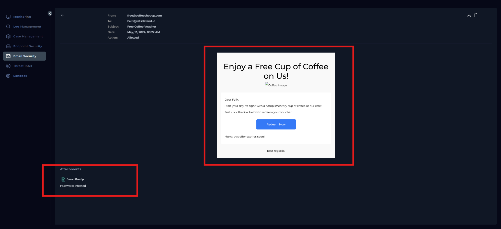

---

## Phase 3: Attachment (Downloaded File) Analysis

To check the ZIP safely, I downloaded it inside the LetsDefend sandbox environment.

**Chrome blocked the download** and warned that the file was potentially dangerous. Because I was working in an isolated analysis environment, I chose to keep the file so I could analyse it.

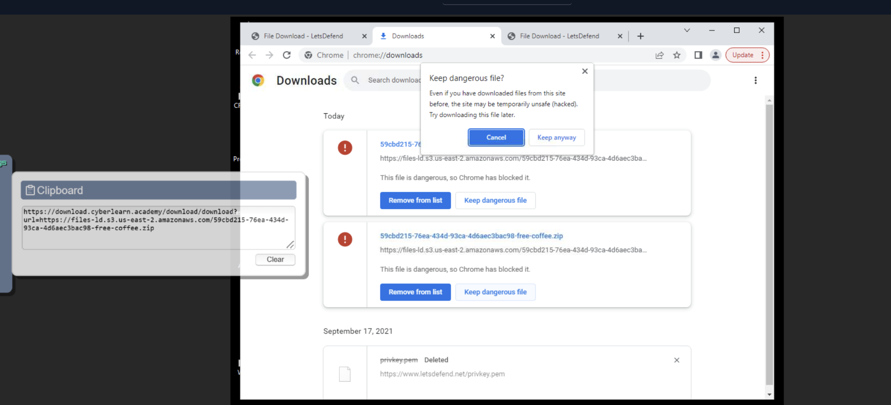

### File hashing

Before touching the archive any further, I generated its SHA-256 hash in PowerShell with `Get-FileHash`:

```powershell
Get-FileHash .\free-coffee.zip -Algorithm SHA256
```

The resulting hash:

```
6F33AE4BF134C49FAA14517A275C039CA1818B24FC2304649869E399AB2FB389
```

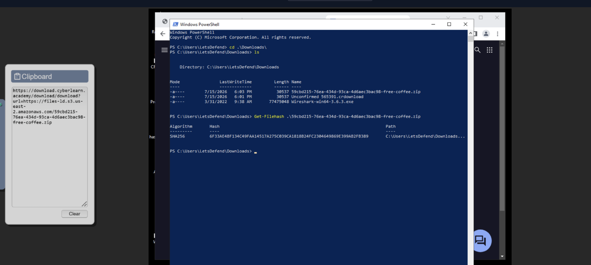

### VirusTotal reputation check

I submitted the hash to **VirusTotal**. The result confirmed what I suspected:

- Detected by **16 out of 62** security vendors
- Classified as **Trojan** and **Worm**
- Family names that came up: **Znyonm**, **ABTrojan**, **AsyncRAT**
- Overall threat label: `trojan.znyonm/abtrojan`

With that many detections and malware family names like AsyncRAT in the mix, I didn't need to extract or run the archive. I treated the file as **malicious**.

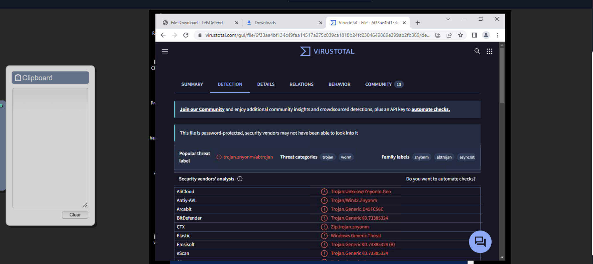

---

## Phase 4: Delivery Verification and Mailbox Cleanup

The alert listed the device action as **Allowed**, so the email had passed the gateway and landed in Felix's mailbox.

Since the file was confirmed malicious, I deleted the email from **Felix's inbox** right away so it couldn't be opened or clicked by mistake.

---

## Phase 5: C2 Hunting in the Network Logs

Next, I wanted to know whether the malware had already run anywhere in the environment. VirusTotal listed several **Command-and-Control (C2)** servers linked to the sample.

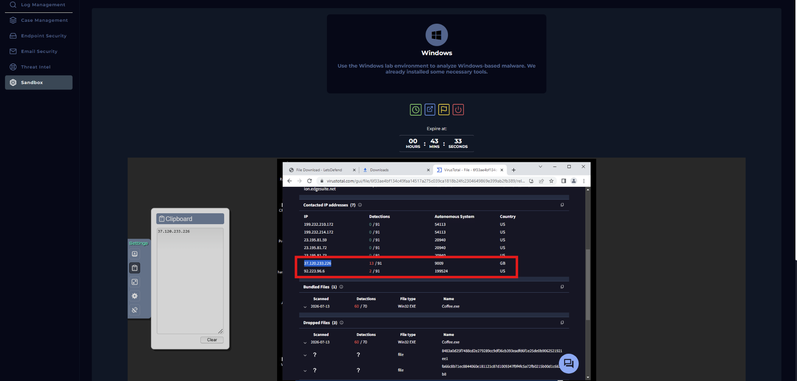

Two of those IP addresses stood out because of their strongly malicious reputations:

> **IOC – C2 IP addresses**
> - `37[.]120[.]233[.]226`
> - `92[.]223[.]96[.]6`

I searched the **Log Management** platform for traffic involving each of these addresses. Both searches came back with **no matching events**.

**{Picture: Log Management search results for the two C2 IP addresses returning no matching events}**

On the strength of that result, I concluded (wrongly, as Part Two shows) that no internal system had communicated with the malware infrastructure and that the file had not been executed.

---

## Phase 6: Threat Intelligence on the SMTP Server

For more context, I checked the sending SMTP server, `103[.]80[.]134[.]63`, in the **Threat Intelligence** panel in LetsDefend.

The IP was already linked to phishing activity. Together with the VirusTotal result, this showed that both the sending infrastructure and the downloaded file were malicious.

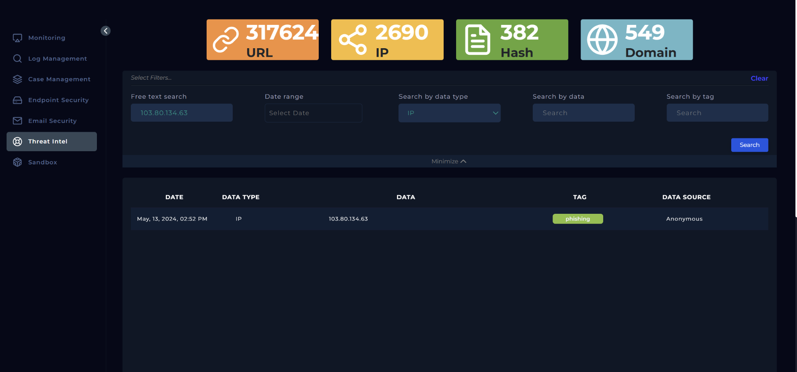

> **IOC – Sending SMTP server:** `103[.]80[.]134[.]63`

---

## Phase 7: Initial Verdict

Based on the evidence at this point, I judged the email to be **malicious**. Supporting indicators:

- Suspicious sender address (`coffeeshooop.com`)
- Social engineering using a free reward
- Urgency designed to pressure the recipient
- A ZIP archive disguised as a voucher
- File detected as malware by multiple vendors
- Sender infrastructure associated with phishing

**Was the email delivered?** Yes. The gateway allowed it into the recipient's mailbox.

**Was the attachment executed?** At this stage I answered **no**. My C2 searches returned nothing, and I had no other evidence of execution.

---

## Phase 8: Containment, Escalation Decision and Closure (First Pass)

For containment, I deleted the malicious email from Felix's mailbox. With no sign of compromise or C2 traffic, I didn't take any other containment action.

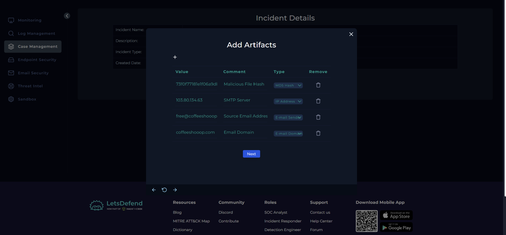

I also decided **Tier 2 escalation wasn't needed**. My reasoning was that the email was removed before anyone could run the file and I'd found no post-compromise activity.

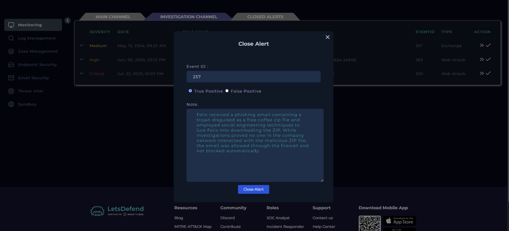

### Initial conclusion

I closed the alert as a **True Positive**:

- A phishing email posing as a **Free Coffee Voucher** reached `Felix@letsdefend.io`.
- It used a free reward and urgency to push the user into downloading a malicious ZIP.
- VirusTotal flagged the file as a **Trojan** tied to the **Znyonm**, **ABTrojan** and **AsyncRAT** families.
- Threat intelligence tied the SMTP server to phishing.
- I found no execution evidence and no C2 traffic, so I deleted the email and did not escalate. **That last part turned out to be wrong, as Part Two shows.**

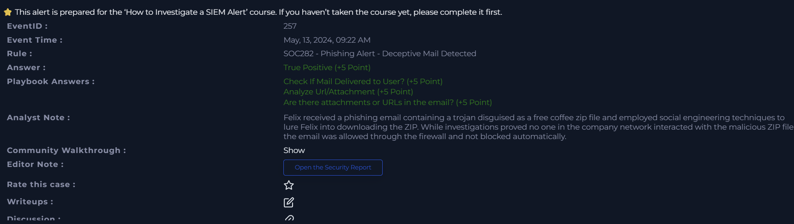

---

# PART TWO – Endpoint Validation

## Why I Went Back

While working through the LetsDefend module, a few of the questions made me realize something. My first investigation had correctly identified the file as malicious, and I'd searched for its known C2 addresses in the network logs. But I never confirmed whether the malware ran **on the endpoint itself**.

Searching for known C2 IPs from VirusTotal is a valid technique, but it only covers the infrastructure I already know about. The strongest proof comes from correlating **endpoint telemetry** with **network activity**. So I reopened the case to find out whether Felix had actually executed the malware.

---

## Phase 9: Locating Felix's Workstation

I found Felix's machine in the **Endpoint Security** panel. His host IP address was:

```
172.16.20.151
```

Rather than going straight to network connections, I first wanted to know whether the ZIP had been downloaded and run at all.

---

## Phase 10: Browser History

Felix's browser history showed that he downloaded the file on **May 13, 2024 at 12:59 PM**. The file came from:

```
files-ld.s3.us-east-2.amazonaws.com/.../free-coffee.zip
```

This changed the direction of the investigation. In Part One I had only shown that the email reached his mailbox. Now I had proof that he'd clicked the link and downloaded the malicious archive, roughly **three hours after the email arrived** (09:22 AM delivery, 12:59 PM download).

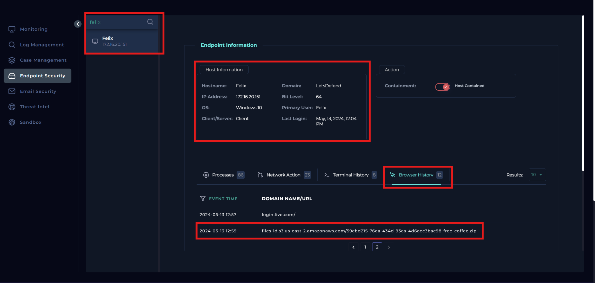

---

## Phase 11: Terminal History

I then looked at the terminal history for the same time window. Right after the download, a burst of system discovery commands ran through **cmd.exe**. They gathered:

- Operating system details
- Hostname
- Available drives
- Local user accounts
- Running services and processes
- Network configuration
- Routing information

All of it executed within a few seconds. That pattern fits the **discovery phase** after malware execution, where the malware profiles the infected host before talking to its operator or doing anything else.

This strongly suggested the ZIP had been both downloaded and **executed**. At that point I **contained the endpoint** to cut off any further communication while I carried on investigating.

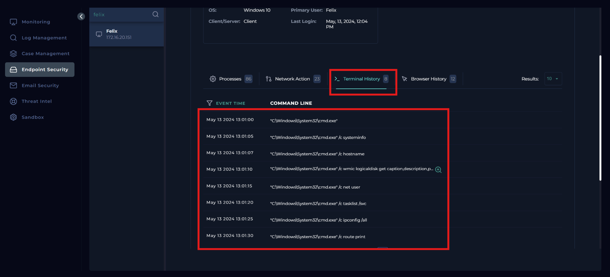


---

## Phase 12: Network Investigation

After containment, I verified the malware's network behavior. This time, instead of searching for the C2 IP, I filtered the logs on **Felix's workstation**. That returned **four network events** shortly after the ZIP download.

**{Picture: Log Management results filtered on 172.16.20.151 showing the four network events}**

The logs showed a new process named `coffee.exe` (**process ID 6697**) opening an outbound TCP connection to:

> **IOC – Confirmed C2:** `37[.]120[.]233[.]226`

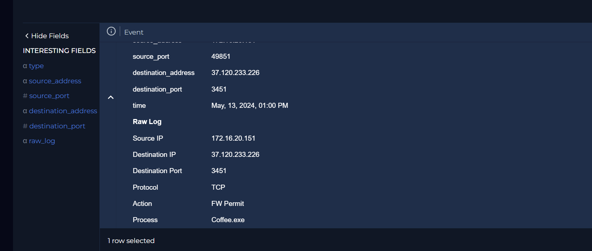

This IP is one of the C2 addresses I'd pulled from VirusTotal in Part One. Seeing it here, tied to a process on Felix's machine, confirmed the malware had run and reached its Command-and-Control server. The firewall **allowed** the outbound connection over **TCP port 3451**.


I also saw a second event from the same process trying to use the same port against the loopback address (`127.0.0.1`). The firewall **denied** that one. It was an interesting detail, but the successful external connection was enough to prove the malware was active on the host.

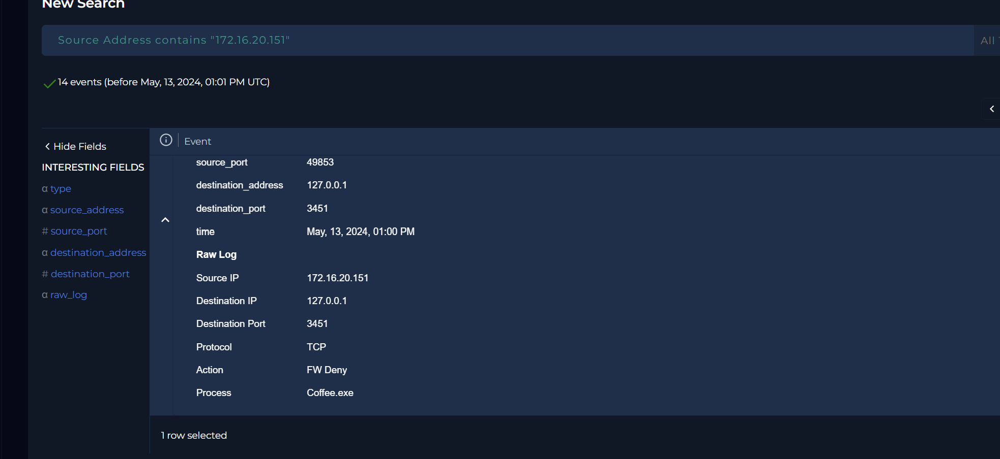

---

## Phase 13: Process Analysis

On the affected host, I reviewed the running processes. The malicious process details:

- **Process name:** `coffee.exe`
- **Process ID:** 6697
- **Image hash (SHA-256):**

```
CD903AD2211CF7D166646D75E57FB866000F4A3B870B5EC759929BE2FD81D334
```

> **IOC – Malware process hash:** `CD903AD2211CF7D166646D75E57FB866000F4A3B870B5EC759929BE2FD81D334`

The process had spawned a **cmd.exe** instance, and that cmd.exe had **7 child processes**, which lined up with the discovery commands I saw in the terminal history.

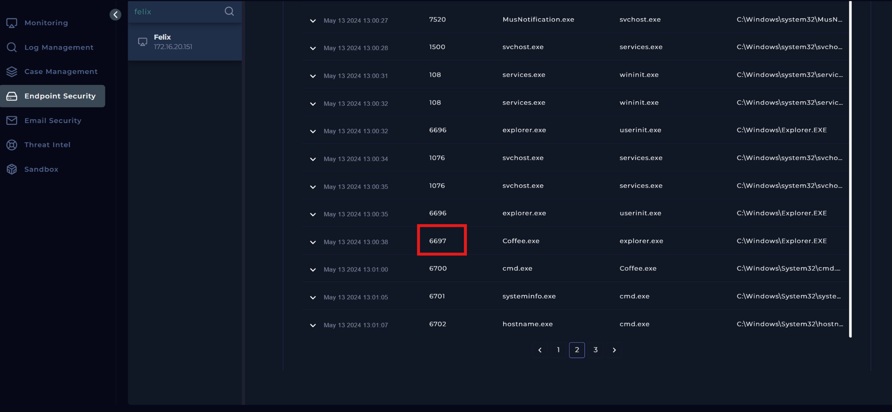

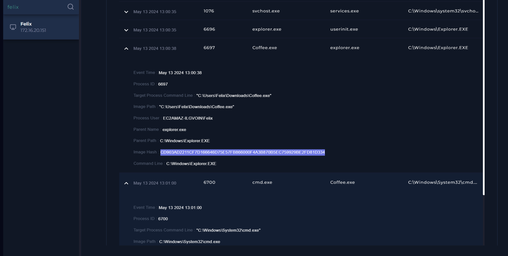

---

## Phase 14: Environment-Wide Verification

Last, I searched Log Management for the confirmed C2 address, `37[.]120[.]233[.]226`, to see whether any other host had talked to it. No other hosts appeared. Based on the telemetry available, **only Felix's workstation** had communicated with the malware infrastructure.

**{Picture: Log Management search for the C2 address returning only Felix's workstation}**

---

## Updated Findings

The extra work changed the result of the case. My first pass confirmed the phishing email and the malicious file, but the endpoint evidence showed that:

- Felix **downloaded** the malicious ZIP archive.
- The malware was **executed**.
- It carried out **host discovery** activity through cmd.exe.
- A process named **coffee.exe** made an **outbound connection to its C2 server**.
- The affected endpoint was **contained**.
- Nothing suggested any other endpoint communicated with the same C2 infrastructure.

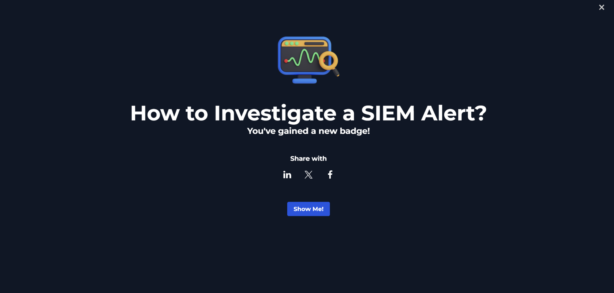

---

## Indicators of Compromise (Summary)

| Type | Indicator |
|---|---|
| Sender address | `free@coffeeshooop.com` |
| SMTP server | `103[.]80[.]134[.]63` |
| Email subject | Free Coffee Voucher |
| Download URL | `files-ld.s3.us-east-2.amazonaws.com/.../free-coffee.zip` |
| ZIP SHA-256 | `6F33AE4BF134C49FAA14517A275C039CA1818B24FC2304649869E399AB2FB389` |
| Malware process | `coffee.exe` (PID 6697) |
| Process image SHA-256 | `CD903AD2211CF7D166646D75E57FB866000F4A3B870B5EC759929BE2FD81D334` |
| C2 IP (confirmed) | `37[.]120[.]233[.]226` (TCP 3451) |
| C2 IP (not observed) | `92[.]223[.]96[.]6` |
| Affected host | `172.16.20.151` (Felix) |

---

## Key Takeaways / Conclusion

- **Threat intel alone isn't proof of execution.** Searching for known C2 IPs found nothing in my first pass, yet the machine was compromised. The C2 address only turned up once I started from the endpoint.
- **Always validate on the host.** Browser history, terminal history, the process list and network logs filtered by the affected host tell you what actually happened, not just what a reputation database knows about.
- **Delivered doesn't mean harmless.** The email was allowed through, and the user downloaded and ran the file hours later. Deleting the message from the inbox doesn't undo a download that already happened.
- **Behavioral patterns matter.** A burst of discovery commands (OS info, users, services, network configuration) right after a download is a strong sign of malware running on a host.
- **Phishing hallmarks held up.** A free reward, urgency, a look-alike sender domain and a link that downloads an archive instead of opening a page were all red flags I could have spotted at the gateway.

Overall, the alert was a **True Positive**, and the investigation ended with a confirmed **endpoint compromise** contained on Felix's workstation.


<!-- Screenshot placeholders retained because no matching screenshot was included in the supplied batch:
- Log Management search results for the two C2 IP addresses returning no matching events
- Log Management results filtered on 172.16.20.151 showing the four network events
- Log Management search for the C2 address returning only Felix's workstation
-->
