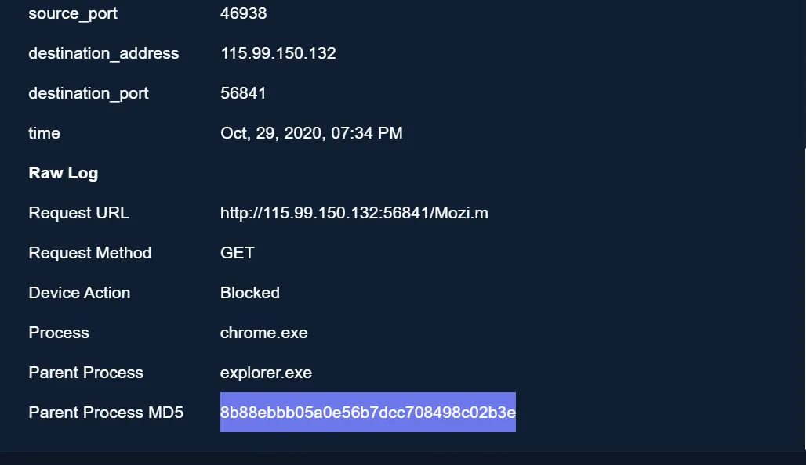
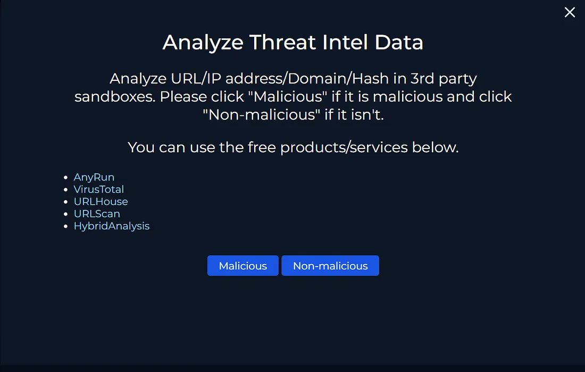
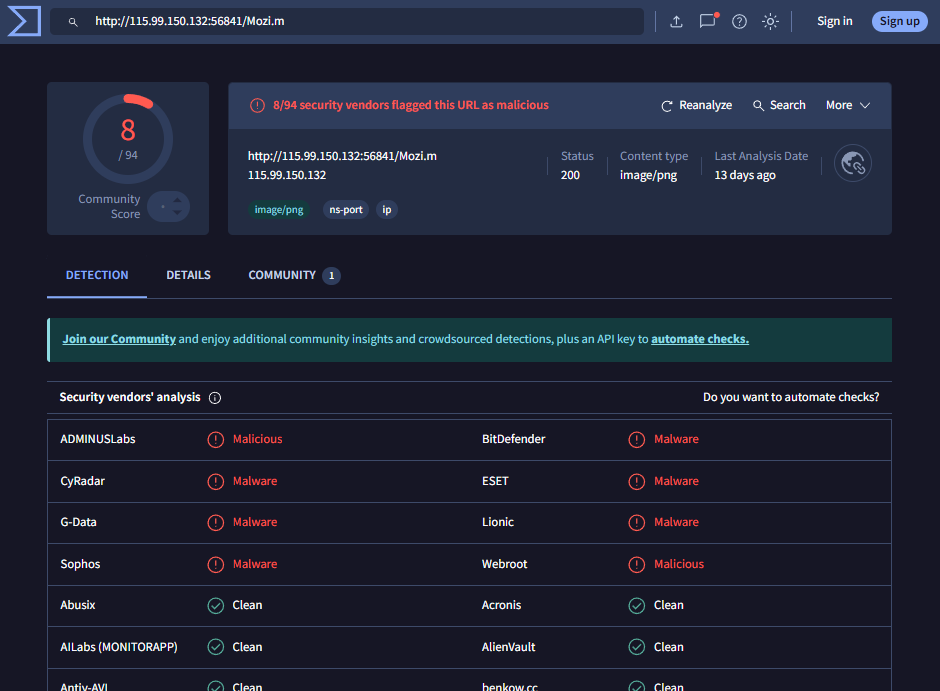
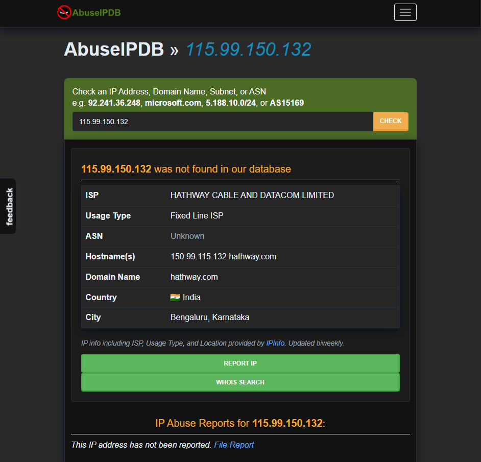
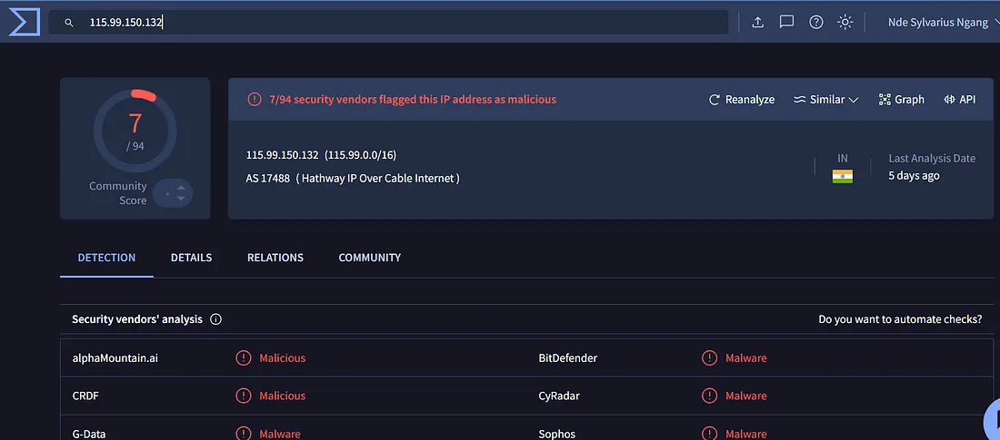
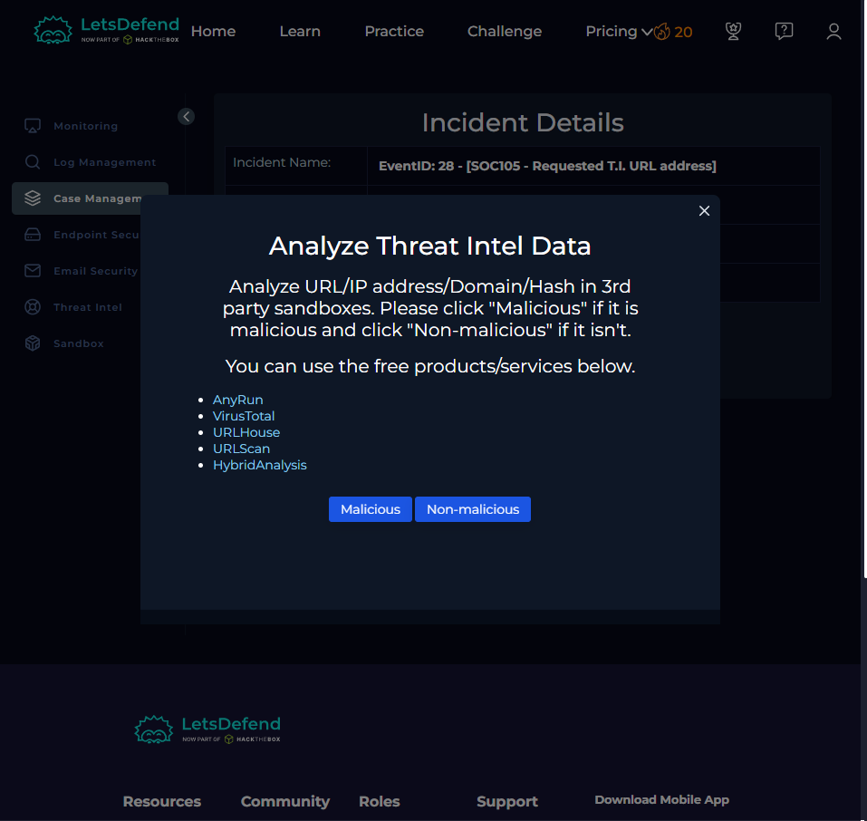
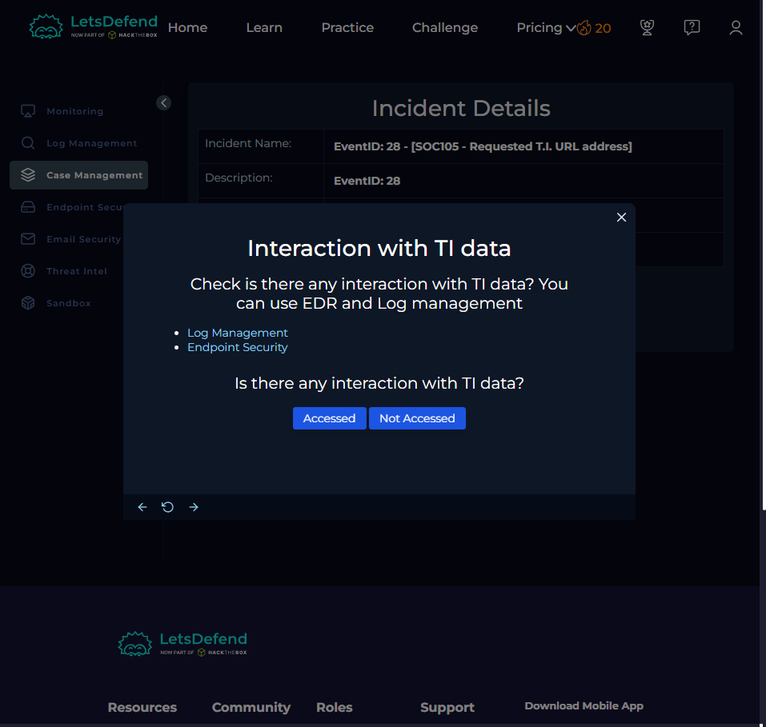
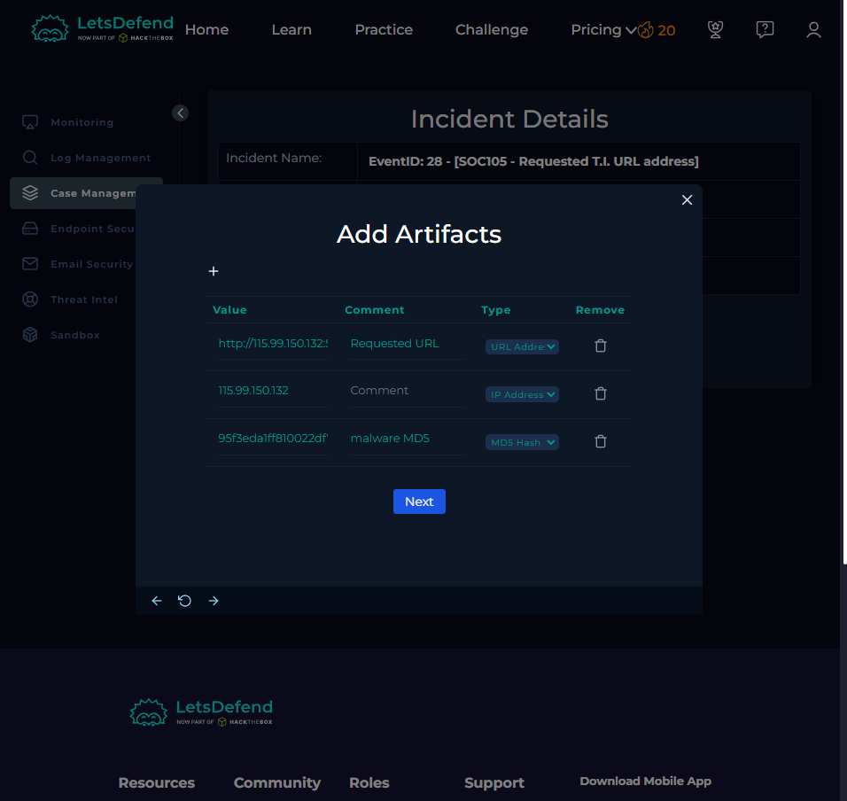
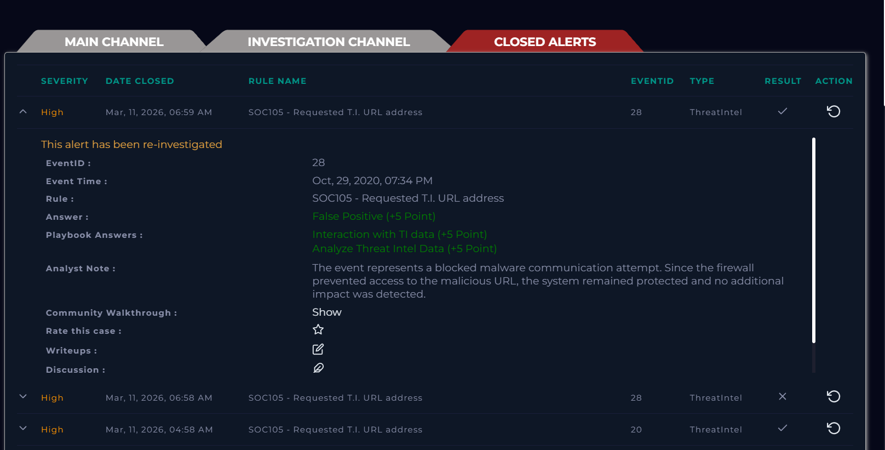

# SOC105 – Requested T.I. URL Address

## 1. Overview

In this LetsDefend SOC investigation, I reviewed an alert generated after an internal endpoint made an HTTP request to an external IP address associated with a threat-intelligence indicator.

The investigation focused on validating the requested URL and destination IP using third-party threat-intelligence services, reviewing the network log, determining whether the security device blocked the request, and documenting the relevant artifacts before closing the alert.

- **Platform:** LetsDefend
- **Alert:** `SOC105 – Requested T.I. URL address`
- **Event ID:** `28`
- **Event time:** October 29, 2020, 07:34 PM
- **Activity:** HTTP GET request to an external IP address
- **Device action:** Blocked

## 2. Initial Alert and Raw Event

I opened the incident in LetsDefend and reviewed the event details. The request was made to:

```text
http://115.99.150.132:56841/Mozi.m
```

The raw event contained the following network and process information:

| Field | Value |
|---|---|
| Source port | `46938` |
| Destination address | `115.99.150.132` |
| Destination port | `56841` |
| Event time | October 29, 2020, 07:34 PM |
| Request method | `GET` |
| Request URL | `http://115.99.150.132:56841/Mozi.m` |
| Device action | `Blocked` |
| Process | `chrome.exe` |
| Parent process | `explorer.exe` |

The requested path, `/Mozi.m`, was suspicious and warranted threat-intelligence validation. I also noted that the event recorded the device action as `Blocked`; I used this as evidence of the control's response, rather than assuming that a malicious request automatically meant the endpoint was compromised.



## 3. Threat Intelligence Validation

LetsDefend prompted me to analyze the URL/IP address/domain/hash using third-party services. The available services included AnyRun, VirusTotal, URLhaus, URLScan, and Hybrid Analysis.



### 3.1 Check the requested URL in VirusTotal

I submitted the requested URL to VirusTotal:

```text
http://115.99.150.132:56841/Mozi.m
```

VirusTotal showed that **8 out of 94 security vendors** flagged the URL as malicious. The result supported treating the requested URL as malicious.

The URL analysis page also displayed HTTP status `200` and content type `image/png` in its analysis details. This is VirusTotal's displayed URL-analysis information; it should not be confused with proof that the specific endpoint request in the LetsDefend event succeeded. The LetsDefend raw event separately recorded the device action as `Blocked`.



### 3.2 Check the destination IP in AbuseIPDB

I then checked the destination IP address in AbuseIPDB:

```text
115.99.150.132
```

AbuseIPDB reported that the IP address was **not found in its database** and showed no abuse reports. The page identified the ISP as `HATHWAY CABLE AND DATACOM LIMITED`, the usage type as `Fixed Line ISP`, and the location as Bengaluru, Karnataka, India.

The absence of AbuseIPDB reports did not establish that the IP was safe. I treated this as one data point and considered it alongside the other threat-intelligence results.



### 3.3 Check the destination IP in VirusTotal

I also searched VirusTotal for the destination IP:

```text
115.99.150.132
```

VirusTotal showed that **7 out of 94 security vendors** flagged the IP address as malicious. This provided additional threat-intelligence evidence supporting the malicious classification.



### 3.4 Classify the URL

After reviewing the available threat-intelligence results, I selected **Malicious** in the LetsDefend analysis prompt.

The URL had multiple vendor detections, and the destination IP also received malicious detections from several vendors. Although AbuseIPDB had no reports for the IP, that result did not outweigh the other evidence.



## 4. Check for Interaction with Threat Intelligence

The next LetsDefend playbook prompt asked whether there had been interaction with the threat-intelligence data. It directed me to review **Log Management** and **Endpoint Security**.

I used the available event information to assess the request and its outcome. The raw log showed an HTTP `GET` request to the suspicious URL, while the device action was recorded as `Blocked`.

Based on the event's recorded action, I selected **Not Accessed** in the playbook.



> **Analyst note:** A request attempt, a blocked connection, and a successful resource access are different outcomes. The `Blocked` action supports the conclusion that the security device prevented the request. I did not treat the VirusTotal URL page's HTTP status as proof of access by this endpoint.

## 5. Add Investigation Artifacts

I added the relevant indicators to the incident as artifacts so they would remain associated with the case.

The artifact types shown in the LetsDefend interface were:

| Artifact | Type | Comment |
|---|---|---|
| `http://115.99.150.132:56841/Mozi.m` | URL Address | Requested URL |
| `115.99.150.132` | IP Address | Destination IP |
| MD5 value displayed in the event | MD5 Hash | malware MD5 |

The screenshot shows the MD5 value only partially, so I have not reproduced an unverified full hash here.



## 6. Final Alert Disposition

After completing the threat-intelligence checks, reviewing the event details, selecting the playbook responses, and adding the artifacts, I reviewed the closed-alert record.

The final record showed:

- **Answer:** False Positive
- **Playbook answer:** Interaction with TI data
- **Playbook answer:** Analyze Threat Intel Data
- **Analyst note:** The event represented a blocked malware communication attempt. The firewall prevented access to the malicious URL, and no additional impact was detected in the investigation.

The case was closed with the result recorded as **False Positive** in LetsDefend.



## 7. Key Findings

| Indicator / Detail | Finding |
|---|---|
| Event ID | `28` |
| Alert rule | `SOC105 – Requested T.I. URL address` |
| Requested URL | `http://115.99.150.132:56841/Mozi.m` |
| Destination IP | `115.99.150.132` |
| HTTP method | `GET` |
| Process | `chrome.exe` |
| Parent process | `explorer.exe` |
| Device action | `Blocked` |
| VirusTotal URL result | `8/94` vendors flagged malicious |
| VirusTotal IP result | `7/94` vendors flagged malicious |
| AbuseIPDB result | IP not found; no abuse reports shown |
| Playbook access assessment | `Not Accessed` |
| LetsDefend closure result | `False Positive` |

## 8. Conclusion and Takeaways

This investigation involved validating a suspicious URL and its destination IP against multiple threat-intelligence sources, then comparing those results with the original network event.

The main findings were:

- VirusTotal reported detections for both the URL (`8/94`) and destination IP (`7/94`).
- AbuseIPDB had no reports for the destination IP, which did not by itself establish that the IP was benign.
- The raw LetsDefend event recorded the HTTP request as `Blocked`.
- I selected `Not Accessed` for the playbook's interaction assessment and added the URL, IP address, and displayed MD5 artifact to the case.
- LetsDefend recorded the final closure result as `False Positive`.

**What I practised:** correlating threat-intelligence results with network-event evidence, interpreting security-device actions, recording IOCs as case artifacts, and distinguishing a malicious request attempt from confirmed successful access.
